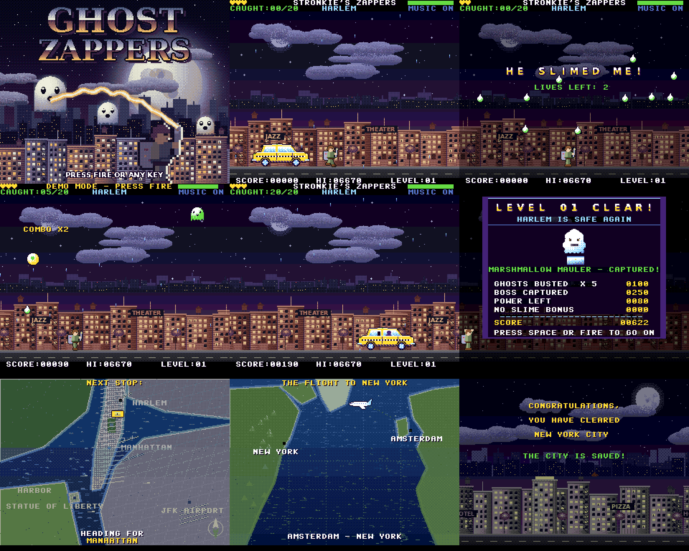

# Ghost Zappers – Amiga version

The Commodore 64 game **Ghost Zappers** (Stronkie's Zappers), ported to the **Amiga 500**. It is written in 68000 machine language and rebuilt with Amiga-style graphics, sampled sound and spoken voices.

Created By Mark Stronks (Stronkie). Code and music written with Claude (Anthropic).

## Download and run

| File | What it is |
|---|---|
| `GhostZappers_V1.2.adf` | Bootable disk image. Boot it, or put it on a Gotek, and the game starts by itself |
| `GhostZappers` | The program itself, for copying to another disk or a hard drive |
| `GhostZappers.info` | Workbench 1.3 icon for the program |
| `GhostZappers.s` | Full 68000 assembly source in one file, with all graphics, music and samples included |
| `ReadMe.txt` | The text file that is also on the disk |

**Requirements:** an Amiga 500 with Kickstart / Workbench 1.3 (PAL), 512 KB chip RAM and the 512 KB trapdoor expansion (1 MB in total). The game also runs in WinUAE with that setup.

Older versions are in [`previous versions`](previous%20versions).

## Controls

| Action | Joystick (port 2) | Keyboard |
|---|---|---|
| Move | left / right | `A` / `D` or the cursor keys |
| Fire the proton beam | fire | `SPACE` or `RETURN` |
| Throw the trap under a stunned boss | up | `T` or `W` |
| Pause menu (`Q` there quits to the title) | | `P` or `ESC` |
| Music on / off | | `M` |

## What changed compared with the C64 version

The game play is the same as on the C64: the same five places of New York, the same ghost types, bosses, attacks, combo scoring, power-ups, Easy / Normal / Hard modes, Hall of Fame and the four bonus games. Everything around it was redone for the Amiga.

**Graphics**
- 320 × 256 PAL screen in dual playfield mode: a painted city in the back, ghosts and text in front.
- A painted backdrop for every place: Harlem, Manhattan, the Harbor, JFK Airport and the Statue of Liberty, plus the New York map and the flight map.
- Three-layer parallax scrolling, each layer with its own palette, and a sky gradient made with the copper.
- New pixel-art ghosts, bats, bosses, power-ups and effects with highlights and shading.
- The hunter is a 32 × 32 hardware sprite in 15 colours, with walk, shoot and cheer frames that face left and right.
- A chrome title logo with a colour gradient, and big gold and blue fonts for headlines.
- A 32-colour loading picture. It now waits for fire or a key before the main menu appears.

**Sound**
- Sampled sound effects: proton beam, ghost caught, slime, power-up, trap, explosions and more.
- Spoken voices: "Get ready", the countdown "3, 2, 1, Go!", "Warning", "Gotcha", "Excellent", "Slimed", "Game over", "Cheat activated" and more.
- Long effects such as thunder, the boss roar and fireworks. They are streamed from slow RAM so the game does not pause to load them.
- The Ghostbusters-style tune plays on three Paula channels, with sound effects on the fourth.

**Cinematic intro and boss fights**
- A letterboxed story intro with lightning and thunder. Ghosts swoop over the city, then the hunter walks in and blasts a ghost.
- A level intro with the place name and a spoken countdown.
- The boss arrives with screen shake, a WARNING banner, the boss laughing, a name card in the letterbox, and the boss growing in from far away before "FIGHT!".
- Stunned bosses show dizzy stars. The trap sucks the boss in as it shrinks, followed by an explosion and "BOSS CAPTURED!".
- Weather per place: rain, lightning flashes with thunder, and drifting fog.
- The ending has fireworks over the city, the flight home and the "Mission Complete" screen.

**Game moments from the C64 version, now on the Amiga**
- The taxi brings the hunter to every place: it drives in, brakes, he gets out and the taxi drives off. After the boss he walks back to the street, the taxi returns, he gets in and they drive away.
- Getting slimed stops the game: the city goes dark, slime runs down the screen and "HE SLIMED ME!" is shown and spoken. Then 3 seconds of invincibility.
- Demo mode: leave the main menu alone for 20 seconds and the computer plays. Fire, the stick or any key stops it.

**Level endings**
- A level-clear panel with the captured boss in the trap and the cheering hunter.
- A counted bonus: 5 points per ghost, 250 for the boss, the power you have left, and 500 if you were never slimed. It is counted up and added to your score (fire skips the counting).

**Test cheat** (works as it did on the C64)
- Type `GHOST` in the main menu. The screen flashes, a voice says "Cheat activated" and **CHEAT ACTIVATED** appears in the menu and next to the lives during play.
- Slime does not hurt you, you lose no lives and the power bar stays full. `N` skips to the next level.
- High scores and bonus-game records made with the cheat are not saved. Type `GHOST` again to switch it off.

## Versions

| Version | Highlights |
|---|---|
| V1.0 | First Amiga 500 port: the whole C64 game in 68000 code, scrolling skyline, music, Hall of Fame saved to disk, bootable ADF and Workbench icon |
| V1.1 | New Amiga-style graphics (painted backdrops, parallax, sprite hunter, chrome logo), sampled sound effects and voices, cinematic intro and boss fights, loading picture waits for a key, GHOST test cheat fixed and shows "CHEAT ACTIVATED" |
| **V1.2** | Demo mode, taxi arrival and drive-off scenes, "HE SLIMED ME!" with 3 s invincibility, counted level-end bonus, quieter music under the voices, more detailed map and flight screens |

## Changelog

### V1.2
- New: demo mode. After 20 seconds without input in the main menu the computer plays a level. Fire, the stick or any key returns to the menu. Nothing is saved.
- New: taxi scenes before and after every level, as in the C64 version, with engine, brake and door sounds.
- New: getting slimed stops the game with "HE SLIMED ME!" in big letters and as a voice, while slime runs down the screen. Afterwards the hunter is invincible for 3 seconds and blinks.
- New: the level-clear screen counts a bonus into the score (ghosts, boss, power left, no-slime bonus), with the captured boss and the cheering hunter.
- Changed: the music is quieter, and drops further while a voice speaks. Sound effects also drop while a voice speaks.
- Changed: more detailed New York map (coasts, shallow water, street grids, Manhattan blocks, Central Park, bridges, ferries, runways) and flight map (texture, mountains, ice, city lights). The city names on the flight map are easier to read.
- Fixed: score popups no longer rise into the top status bar.
- Graphics can now slide in and out at the left and right edges of the screen.

### V1.1
- All graphics redone in the style of Amiga games of the time. The details are listed above.
- Sampled sound effects and spoken voices added.
- Letterboxed story intro with lightning, thunder and an opening scene.
- Boss fights made more cinematic: approach, warning, name card, grow-in, dizzy stars, suck-in, explosion.
- Fireworks at the end. Every life left is worth 1000 points.
- The loading picture waits for fire or any key.
- Fixed: typing `GHOST` in the main menu did nothing. It now switches on the test cheat: no slime damage, no lives lost, full power bar, `N` skips a level, no Hall of Fame entry. The screen flashes and "CHEAT ACTIVATED" is shown.
- Fixed: typing `S` and `T` in `GHOST` no longer moves the menu cursor.
- Text lines on the info pages are spaced further apart.

### V1.0
- First release of the Amiga 500 port.
